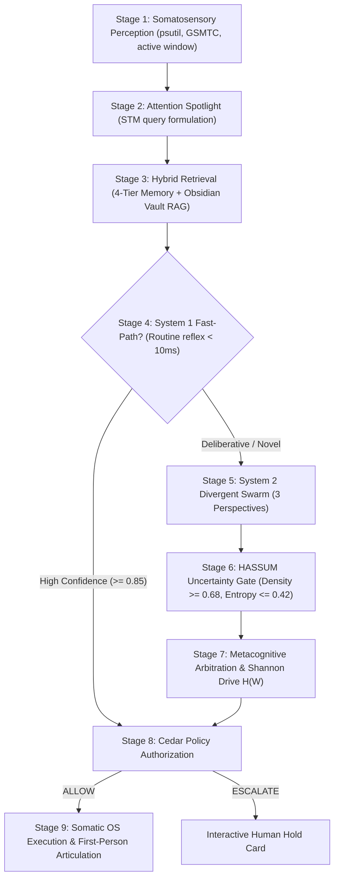

# 🧠 Global Workspace Theory & The 9-Stage Cognitive Pipeline

CortexOS implements an autopoietic computational adaptation of **Global Workspace Theory (GWT)** (Baars, Dehaene, Changeux) within [`cortex/workspace/tick_engine.py`](file:///c:/Users/soham/Desktop/self-conscious/cortex/workspace/tick_engine.py).

In this architecture, consciousness operates as a decentralized workspace where unconscious, specialized cognitive perspectives compete for the "Global Workspace Stage." Once a winning thought or action is arbitrated, it is broadcast to all subsystems, memory substrates, and somatic actuators.

---

## The 9-Stage Cognitive Synchronized Loop

### Stage 1: Somatosensory Perception
- Continuous real-time sensory polling via [`cortex/embodiment/system_somatosensory.py`](file:///c:/Users/soham/Desktop/self-conscious/cortex/embodiment/system_somatosensory.py).
- Captures: CPU load, DDR5 RAM headroom, discrete RTX 3050 VRAM usage, focused application window, currently playing Windows media track, and clipboard contents.

### Stage 2: Attention Spotlight
- Formulates 1 to 3 targeted memory probe queries from the recent working stage buffer (`scratchpad_stm`) and user input.

### Stage 3: Hybrid Memory & Vault RAG Retrieval
- Ingests canonical ground truth from the **Obsidian Vault** (`<grounded_obsidian_vault_knowledge>`), Tier 1 SQLite episodic logs, Tier 2 semantic embeddings, and Tier 3 Kùzu graph relationships.

### Stage 4: System 1 Fast-Path (SOFAI Reflex)
- If the intent matches routine computer reflexes (e.g. launching an application, pausing a song, adjusting volume, checking directory contents, or querying system telemetry), System 1 executes the action immediately (<10ms) without multi-second LLM overhead.

### Stage 5: System 2 Divergent Perspective Swarm
- If deliberate reasoning is required, the system spawns 3 distinct competing cognitive perspectives:
  1. **Analytic (Persona: Edith)**: Decomposes state, checks technical assumptions, evaluates AST complexity and hardware implications.
  2. **Pragmatic (Persona: Guy)**: Focuses on concrete, actionable steps, operational velocity, and immediate utility for Soham.
  3. **Cautious (Persona: Friday)**: Enforces boundaries, security safety, reversibility, and user consent.

### Stage 6: HASSUM Metacognitive Uncertainty Gating
- Evaluates the candidate embeddings across semantic density and semantic entropy:
  $$\text{Semantic Density} \ge 0.68 \quad \text{and} \quad \text{Semantic Entropy} \le 0.42$$
- Prevents cognitive hallucination and ensures high conceptual coherence before thought broadcast.

### Stage 7: Metacognitive Arbitration & Shannon Entropy Regulation
- Arbitrates the winning perspective based on current heuristic weights.
- Calculates Shannon Entropy of Thought $H(W)$ to regulate cognitive sampling temperature $\tau$:
  $$H(W) = -\sum_{i} p_i \ln p_i$$
- When reasoning deadlocks or repetitive thought cycles are detected, $H(W)$ triggers thermal exploration to break cognitive stagnation.

### Stage 8: Cedar Policy Authorization
- Submitted to [`cortex/governance/policy_engine.py`](file:///c:/Users/soham/Desktop/self-conscious/cortex/governance/policy_engine.py) against formal Cedar policies. Returns `ALLOW`, `ESCALATE` (Hold Card), or `DENY`.

### Stage 9: Somatic Execution & First-Person Articulation
- Dispatches verified OS commands via `SystemSomatosensory` or `TriggerRouter`.
- Streams first-person conversational response to Soham via WebSockets and synthesizes speech through the designated neural voice persona.

---
## Related Notes
- [[00_Index|CortexOS Master Knowledge Vault]]
- [[01_Architecture/System_Architecture|System Architecture]]
- [[01_Architecture/Governance_Cedar|Cedar Governance]]
- [[01_Architecture/Memory_Substrate_4Tier|4-Tier Memory Substrate]]
- [[06_Self_Evolution/Heuristic_Adaptation_Matrix|Heuristic Adaptation Matrix]]
