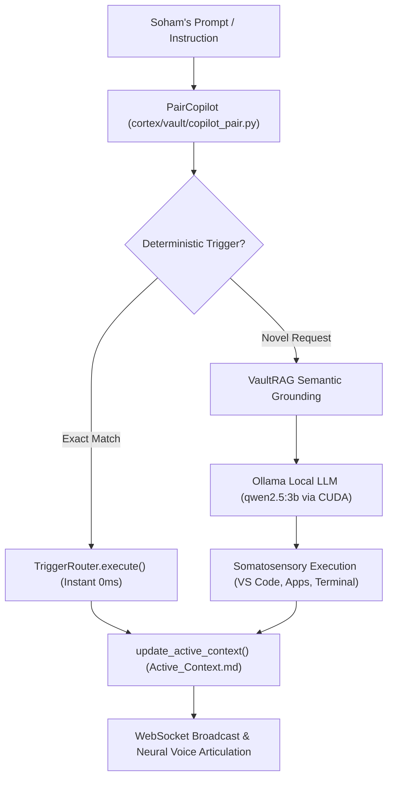

# 👥 Pair Programming Copilot Architecture

The **CortexOS Pair Programming Copilot** ([`cortex/vault/copilot_pair.py`](file:///c:/Users/soham/Desktop/self-conscious/cortex/vault/copilot_pair.py)) operates as a peer collaborator alongside lead engineer Soham. Instead of acting as a passive text chatbot, it maintains deep environmental awareness, reads and writes to this Obsidian Vault, and directly executes operational actions on the host machine.

---

## 🤝 Core Behavioral Pillars

### 1. High Autonomy with Calibrated Restraint
- **Empowered System Execution**: The copilot is authorized to compile code, run pytest suites, inspect files, launch external applications, adjust audio volume, and switch desktop workspaces autonomously.
- **Escalation Hold Cards**: For high-consequence operations (remote git pushes, external communications, system configuration deletes), the copilot halts and presents an interactive Cedar Hold Card for operator approval.

### 2. Zero-Hallucination Grounding
- Before articulating a recommendation or taking action, `PairCopilot` queries `VaultRAG.retrieve_grounded_context()`.
- File paths, function names, and system capabilities are continuously verified against real filesystem checks and the 48 desktop project directories cataloged in [[07_Workspace_Index/Desktop_Workspace_Master_Index]].

### 3. Immediate Action Dispatch Pipeline
- When Soham requests an operational action (e.g. `"open project voice-lab"`, `"run tests"`, `"scan system"`, `"mute audio"`), the copilot dispatches the tool or system call directly without lecturing.

### 4. Living Context Preservation
- Every milestone, user instruction, and tool dispatch dynamically updates [[02_Pair_Programming/Active_Context|Active Living Context]], maintaining an unbroken operational thread across conversation and server reboots.

---
## Related Notes
- [[00_Index|CortexOS Master Knowledge Vault (MOC)]]
- [[02_Pair_Programming/Active_Context|Active Living Context]]
- [[02_Pair_Programming/User_Preferences|Operator Profile & Preferences]]
- [[02_Pair_Programming/Execution_Playbooks|Immediate Action Execution Playbooks]]
- [[04_Skills_Catalog/Trigger_Registry|Deterministic Trigger Registry]]
