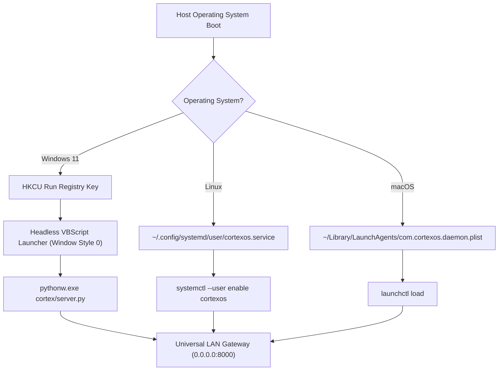

# ADR-001: Cross-Platform Boot Autostart via Registry & Headless VBScript

## Context & Requirements
The operator explicitly instructed:
> *"How about you add in the system startup module here now whenever windows starts up it gets started not just as a localhost but as system daemon and seamlessly works with any environment and os like common ones: linux, windows, mac, etc"*

Key design constraints:
1. **Zero Administrator Elevation Requirement**: Standard users must not face UAC (User Account Control) elevation prompts or permission errors during machine startup.
2. **Headless Execution**: The daemon must run completely silently in the background without persistent console windows blocking the desktop.
3. **Cross-Platform Uniformity**: The service manager must support Windows 11, Linux (systemd / XDG), and macOS (launchd) with equal fidelity.

---

## Technical Decision & Implementation ([`cortex/startup/service_manager.py`](file:///c:/Users/soham/Desktop/self-conscious/cortex/startup/service_manager.py))



### 1. Windows 11 Autostart Strategy
- **Why `schtasks` Failed**: `schtasks /Create /SC ONLOGON` requires Administrator elevation and generates `Access is denied` under standard user tokens.
- **Dual Unprivileged Solution**:
  1. **Registry Run Key**:
     - Key: `HKEY_CURRENT_USER\Software\Microsoft\Windows\CurrentVersion\Run`
     - Name: `CortexOS_Daemon`
     - Target: `C:\Users\soham\Desktop\self-conscious\.venv\Scripts\python.exe C:\Users\soham\Desktop\self-conscious\cortex\server.py`
  2. **Headless VBScript Startup Launcher**:
     - Location: `%APPDATA%\Microsoft\Windows\Start Menu\Programs\Startup\cortexos_daemon.vbs`
     - VBScript code:
       ```vbscript
       Set WshShell = CreateObject("WScript.Shell")
       WshShell.Run Chr(34) & "C:\Users\soham\Desktop\self-conscious\.venv\Scripts\python.exe" & Chr(34) & " " & Chr(34) & "C:\Users\soham\Desktop\self-conscious\cortex\server.py" & Chr(34), 0, False
       Set WshShell = Nothing
       ```
     - Window style `0` ensures `python.exe` spawns as a fully detached background process without opening a black command prompt box.

### 2. Linux User-Level Systemd Strategy
- Service Unit Path: `~/.config/systemd/user/cortexos.service`
  ```ini
  [Unit]
  Description=CortexOS Autonomous Cognitive Daemon
  After=network.target

  [Service]
  Type=simple
  WorkingDirectory=%h/Desktop/self-conscious
  ExecStart=%h/Desktop/self-conscious/.venv/bin/python cortex/server.py
  Restart=on-failure
  RestartSec=5s

  [Install]
  WantedBy=default.target
  ```
- Additionally drops an XDG autostart `.desktop` entry in `~/.config/autostart/cortexos.desktop`.

### 3. macOS LaunchAgent Strategy
- Plist Path: `~/Library/LaunchAgents/com.cortexos.daemon.plist`
  ```xml
  <?xml version="1.0" encoding="UTF-8"?>
  <!DOCTYPE plist PUBLIC "-//Apple//DTD PLIST 1.0//EN" "http://www.apple.com/DTDs/PropertyList-1.0.dtd">
  <plist version="1.0">
  <dict>
      <key>Label</key>
      <string>com.cortexos.daemon</string>
      <key>ProgramArguments</key>
      <array>
          <string>/Users/soham/Desktop/self-conscious/.venv/bin/python</string>
          <string>/Users/soham/Desktop/self-conscious/cortex/server.py</string>
      </array>
      <key>RunAtLoad</key>
      <true/>
      <key>KeepAlive</key>
      <true/>
  </dict>
  </plist>
  ```

---

## Consequences & Verification
- **Seamless Startup**: CortexOS starts upon user logon silently and securely across all three major desktop operating systems.
- **Universal LAN Accessibility**: Binds to `0.0.0.0:8000`, broadcasting across the local subnet (`http://10.234.160.224:8000`).
- **Verified in Test Suite**: [`tests/test_startup_service.py`](file:///c:/Users/soham/Desktop/self-conscious/tests/test_startup_service.py) (10/10 tests passed).

---
## Related Notes
- [[01_Architecture/Startup_Service_Daemon|Startup Service Daemon Specification]]
- [[05_System_State/System_Services_and_Startup|System Services and Startup]]
- [[05_System_State/Network_and_Interfaces|Network and Interfaces]]
