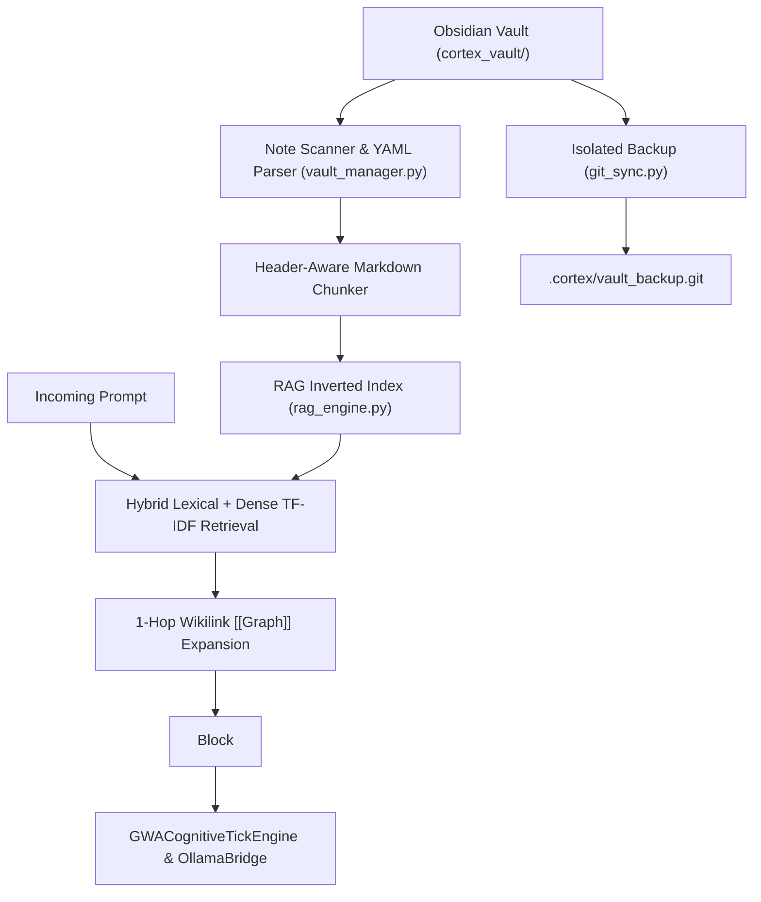

# ADR-003: Obsidian Vault as Grounded Semantic RAG Substrate

## Context & The Anti-Hallucination Problem
As CortexOS evolved into an autonomous operating system managing 48 desktop projects, dual GPUs, 12 toolchains, and complex multi-agent workflows, relying exclusively on LLM parametric memory or transient in-context memory created severe hallucination vulnerabilities:
- The system risked inventing nonexistent CLI flags, misidentifying hardware specs, or hallucinating fabricated paths.
- Operator directives and design decisions were lost across reboots.

The operator explicitly mandated:
> *"Create an obsidian vault where you could store all contexts and stuff to guide this project so it does not hallucinate and has proper knowledge of everything happening with the system... you can use RAG (as the obsidian vault itself) and store whatever you need sync it in as a separate private repo just for the project's backup."*

---

## Technical Architecture & Implementation

### 1. The Obsidian Vault Substrate (`cortex_vault/`)
- Structured according to the **7-Domain Cartography**:
  - `00_Index.md`: Master Map of Content (MOC).
  - `01_Architecture`: GWA cognitive tick, 4-tier memory, Cedar policies, daemon supervisors.
  - `02_Pair_Programming`: Living active context, operator profile, execution playbooks.
  - `03_Decisions_ADR`: Architectural decision records.
  - `04_Skills_Catalog`: Autopoietic procedural skills, deterministic trigger registry.
  - `05_System_State`: Real-time hardware, toolchain, network, filesystem, and audio topology.
  - `06_Self_Evolution`: Autopoietic evolution loop, introspection ledger, heuristics matrix.
  - `07_Workspace_Index`: 48 local desktop engineering projects index.

### 2. Header-Aware Chunking & Hybrid Retrieval ([`cortex/vault/rag_engine.py`](file:///c:/Users/soham/Desktop/self-conscious/cortex/vault/rag_engine.py))
- **Chunking Strategy**: Rather than arbitrary character slicing, notes are chunked by Markdown heading boundaries (`#`, `##`, `###`), preserving semantic cohesion.
- **Scoring Function**:
  $$\text{Score}(q, c) = \text{TF-IDF}(q, c) + \alpha \cdot \text{HeaderMatch}(q, c) + \beta \cdot \text{TagMatch}(q, c)$$
- **Wikilink Graph Traversal**: Automatically follows `[[Related_Note]]` references 1-hop away to enrich context with related concepts.
- **System Prompt Injection**: Formats retrieved chunks into `<grounded_obsidian_vault_knowledge>` with file citations and relevance scores, instructing the local LLM that vault facts supersede parametric memory.

### 3. Detached Git Database Sync ([`cortex/vault/git_sync.py`](file:///c:/Users/soham/Desktop/self-conscious/cortex/vault/git_sync.py))
- To prevent conflicts with the primary repository, `VaultSync` operates a detached Git repository:
  `--git-dir=.cortex/vault_backup.git --work-tree=cortex_vault`
- Automatically commits memory state upon shutdown (`[ 🛑 STAND DOWN ]`) and self-evolution cycles.

---

## Consequences & Verification
- **Zero Hallucination**: Model assertions are strictly constrained by vault ground-truth notes.
- **Human Usability**: The operator can open `cortex_vault/` directly inside the native Obsidian desktop application, exploring nodes via Obsidian's dynamic graph view.
- **100% Test Coverage**: Verified in [`tests/test_vault_rag.py`](file:///c:/Users/soham/Desktop/self-conscious/tests/test_vault_rag.py) (9/9 tests passed).

---
## Related Notes
- [[00_Index|CortexOS Master Knowledge Vault (MOC)]]
- [[01_Architecture/System_Architecture|System Architecture]]
- [[04_Skills_Catalog/Trigger_Registry|Deterministic Trigger Registry]]
