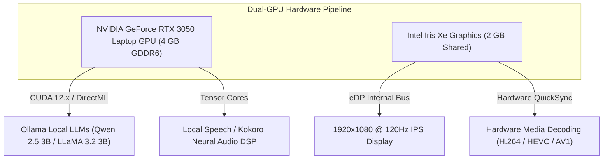

# 🖥️ Display Substrate & Dual-GPU Graphics Topology

Hardware acceleration profiles, display resolution pipes, refresh rates, and dual-GPU compute capabilities on host node `SOHAM`.

---

## 🖥️ Active Display Output Specifications

- **Panel Type**: 15.6" Full HD IPS Display (Dell G15 Internal eDP Panel)
- **Current Resolution**: **`1920 x 1080`** (Full HD, 32-bit RGBA color depth)
- **Hardware Refresh Rate**: **`120 Hz`** (Smooth high-framerate rendering)
- **Display Controller**: Directly driven by the **Intel® Iris® Xe Graphics** display engine via internal eDP bus (Optimus dynamic switching architecture).
- **Window Management**: Windows DWM (Desktop Window Manager) composited with somatosensory active foreground window tracking ([`cortex/embodiment/system_somatosensory.py`](file:///c:/Users/soham/Desktop/self-conscious/cortex/embodiment/system_somatosensory.py)).
- **UI Render Architecture**: Clean static 2D high-contrast developer theme (`#080c16`) rendering at native **120 FPS** with zero Three.js 3D WebGL background overhead or mouse-tilt distortion.

---

## 🎮 Dual-GPU Compute & Neural Acceleration Substrate

### 1. Discrete GPU: NVIDIA® GeForce RTX™ 3050 Laptop GPU
- **Compute Architecture**: Ampere (GA107M, Compute Capability `8.6`)
- **Execution Resources**:
  - CUDA Cores: **2,048**
  - Tensor Cores: **64** (3rd Generation Tensor Cores with TF32 & FP16 acceleration)
  - Ray Tracing Cores: **16** (2nd Generation RT Cores)
- **Dedicated Video Memory (VRAM)**: **`4,293,918,720 bytes` (~4.0 GB) GDDR6** (128-bit bus, 192 GB/s)
- **Driver Version**: `32.0.16.1687` (NVIDIA WDDM 3.2, DirectML and CUDA 12.x capable)
- **CortexOS Role**:
  - Primary hardware accelerator for local Ollama models (`qwen2.5:3b`, `dolphinlabs/llama3.2-3b-uncensored:latest`, `gemma3:4b`).
  - PyTorch CUDA acceleration for neural voice synthesis (`Kokoro-82M ONNX` / `Piper`).

### 2. Integrated GPU: Intel® Iris® Xe Graphics
- **Architecture**: Intel Gen12 Xe-LP
- **Execution Resources**: 80 Execution Units (640 Shading Units)
- **Memory Allocation**: Dynamic shared memory pool up to `2,147,479,552 bytes` (~2.0 GB) allocated from host DDR4 RAM.
- **Driver Version**: `32.0.101.7088` (Intel WDDM 3.1)
- **CortexOS Role**:
  - Low-power desktop display driving at 120 Hz.
  - Video hardware acceleration (Intel QuickSync video decode engine).
  - Offloads GUI compositing from the RTX 3050 so full VRAM is dedicated to local LLM inferencing.

---
## Related Notes
- [[05_System_State/System_Telemetry|Live System Telemetry]]
- [[05_System_State/Hardware_Topology|Hardware Topology]]
- [[05_System_State/Local_Inference_Topology|Local Inference Topology]]
- [[01_Architecture/Local_Ollama_Inference_Substrate|Local Ollama Inference Substrate]]
