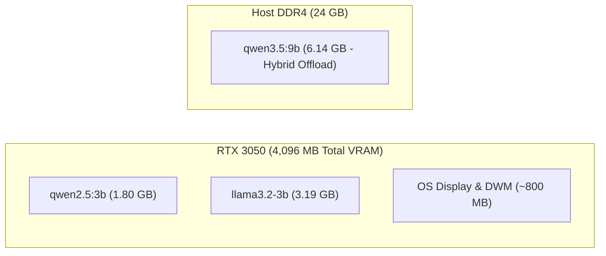

# Local Inference & GPU Topology

- **Host Machine**: Windows 11 Laptop (Dell G15)
- **Primary Inference Accelerator**: NVIDIA GeForce RTX 3050 Laptop GPU (4,096 MB VRAM GDDR6, Ampere Architecture)
- **Secondary Compute Engine**: Intel Core i5-12500H (12 Cores / 16 Threads, AVX2, AVX-VNNI) + 24 GB RAM
- **Ollama Binary**: `C:\Users\soham\AppData\Local\Programs\Ollama\ollama.exe`
- **Default Listening Port**: `127.0.0.1:11434`

## VRAM Allocation & Model Footprints

### 1. `qwen2.5:3b` Footprint
- Model weights: 1.80 GB
- KV cache context (4,096 tokens): ~350 MB
- Total VRAM utilized: ~2.15 GB
- Headroom remaining on RTX 3050: ~1.95 GB
- Average inference latency: **~1.2 seconds to first token**, ~45 tokens/sec generation speed.

### 2. `dolphinlabs/llama3.2-3b-uncensored:latest` Footprint
- Model weights: 3.19 GB
- Fully offloaded to GPU with ~500 MB headroom for OS display compositing.

### 3. `nandhank/qwen3.5-abliterated-truthful:9b` Footprint
- Model weights: 6.14 GB
- Operates in hybrid offload mode: 24 layers offloaded to RTX 3050 VRAM (3.0 GB), with remaining layers processed by CPU threads using AVX2 acceleration across the 24 GB host memory.

## Health Probes & Fallback Matrix
1. **Ollama Online + VRAM Available**: Full System 2 local cognitive autonomy with live action execution.
2. **Ollama Responsive + VRAM Pressure**: Automatically falls back to `qwen2.5:3b` to prevent CUDA Out-of-Memory (OOM) driver resets.
3. **Ollama Offline**: Instant fallback to deterministic GWA cognitive tick engine (`GWACognitiveTickEngine`).

---
## Related Notes
- [[01_Architecture/Local_Ollama_Inference_Substrate]]
- [[05_System_State/Hardware_Topology]]
- [[05_System_State/Toolchains_and_Compilers]]
