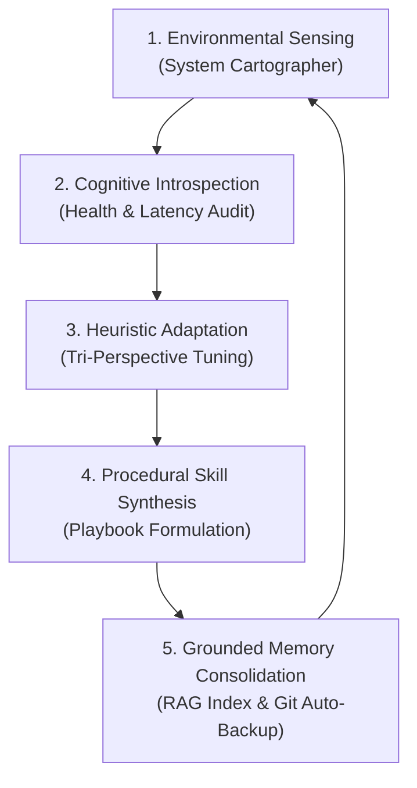

# 🧬 Autonomous Evolution Architecture & Self-Autonomy Loop

CortexOS is designed not as a static assistant, but as an **autopoietic, self-evolving cognitive operating system**. It maintains continuous situational awareness over host hardware, runtime toolchains, and operator habits, using its [[00_Index|Obsidian Knowledge Vault]] as both its long-term episodic memory and self-governing ground truth.

---

## 🔁 The 5-Phase Self-Evolution Cycle

### Phase 1: Sensory Grounding & Cartography
- **Mechanism**: [[05_System_State/Hardware_Topology|System Cartographer]] scans CPU, dual GPUs (NVIDIA RTX 3050 + Intel Iris Xe), 24GB RAM, disk volumes, 12 developer toolchains, and 48 desktop project directories.
- **Diff Detection**: Compares current posture against previous snapshots (`cartography_cache.json`) to detect new compilers, modified storage thresholds, network IP migrations, or new repositories.

### Phase 2: Cognitive Introspection & Somatosensory Audit
- **Mechanism**: The [[06_Self_Evolution/Introspection_Ledger|Introspection Ledger]] measures cognitive tick latency, memory consumption, entropy drift, and execution error rates.
- **Health Metric**: Calculates a unified **System Health Index (0–100%)**:
  $$\text{Health Index} = 100 - (\text{RAM}_{\text{used}} \times 0.35 + \text{Disk}_{\text{used}} \times 0.25 + \text{CPU}_{\text{load}} \times 0.20 + \text{ErrorRate} \times 0.20)$$

### Phase 3: Dynamic Heuristic Adaptation
- **Mechanism**: The [[06_Self_Evolution/Heuristic_Adaptation_Matrix|Heuristic Adaptation Matrix]] adjusts arbitration weights for the tri-perspective specialist agents:
  - **`Analytic` ($W_A$)**: Elevated when environmental diffs or structural errors are high.
  - **`Pragmatic` ($W_P$)**: Elevated during routine operator coding pairing and high-confidence tasks.
  - **`Cautious` ($W_C$)**: Elevated when system resources are constrained or destructive operations are detected.
- **Dynamic Temperature**: Modulated automatically:
  $$T = \text{clamp}(0.1, 0.8, 0.35 + 0.25 \times \text{Entropy})$$

### Phase 4: Autopoietic Skill Synthesis
- **Mechanism**: When CortexOS observes repeated multi-step workflows or receives explicit procedural guidance from operator Soham, the [[06_Self_Evolution/Skill_Synthesis_Engine|Skill Synthesis Engine]] autonomously packages the workflow into an executable skill in [[04_Skills_Catalog/Skills_Registry|Skills Registry]] and [[02_Pair_Programming/Execution_Playbooks|Execution Playbooks]] without requiring code refactoring.

### Phase 5: Grounded Consolidation & Shadow Backup
- **Mechanism**: All learnings, newly discovered tool paths, and updated metrics are written to the Obsidian Vault, immediately re-indexed into [[03_Decisions_ADR/ADR-003-Obsidian-Vault-RAG|Anti-Hallucination RAG]], and version-controlled via the isolated private Git repository (`.cortex/vault_backup.git`).

---

## 🛡️ Autonomy & Governance Principles
All autonomous actions obey [[06_Self_Evolution/Autonomy_Boundaries_and_Escalation|Autonomy Boundaries & Escalation Policies]] and Cedar policies:
1. **Never Hallucinate**: If an action is not grounded in the vault or verified toolchains, execution halts and queries the operator.
2. **Self-Healing**: If a daemon stalls, the [[01_Architecture/Autonomous_Daemons|StallBreaker Sentinel]] automatically restarts the supervisor without crashing the OS.
3. **Continuous Grounding**: As the host system evolves (e.g. installing new libraries or creating new projects), CortexOS automatically maps them into its cognitive context.
