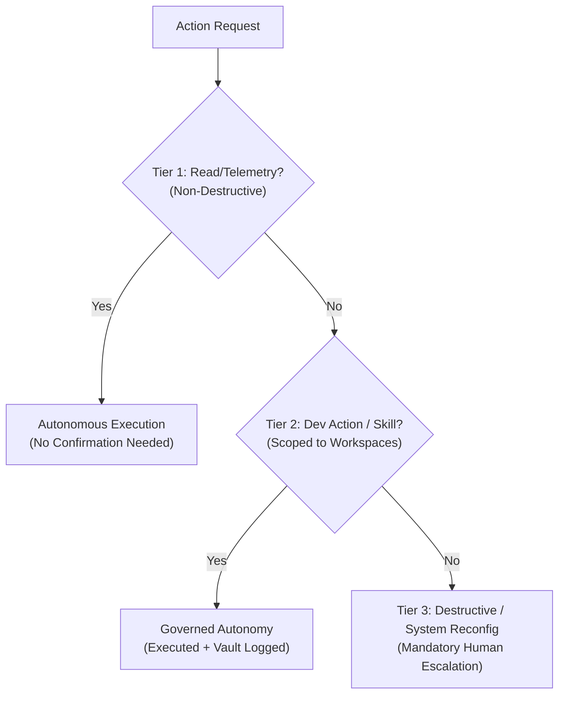

# 🛡️ Autonomy Boundaries, Cedar Policies & Escalation Matrix

CortexOS is designed to operate with **full self-autonomy** over Soham's machine to perform expected developer tasks, while maintaining ironclad safety boundaries to prevent system damage, data loss, or unrecoverable state drift.

## 🎚️ The 3 Tiers of System Autonomy



---

### Tier 1: Full Autonomy (Auto-Dispatched)
*These actions require zero operator interaction and run continuously or periodically:*
- **Hardware & Environment Telemetry**: Reading CPU, GPU, RAM, disk, and sensor posture.
- **Cartography Scans**: Periodic background sweeps of installed tools, ports, and project directories.
- **RAG Semantic Re-Indexing**: Updating BM25 and vector chunk embeddings upon file modification.
- **Cache & Scratch Trimming**: Cleaning temporary demonstration artifacts older than 48 hours.
- **Vault Private Backup Sync**: Auto-committing markdown knowledge updates to the isolated Git repository (`.cortex/vault_backup.git`).
- **Health Introspection**: Logging metric reflections into [[06_Self_Evolution/Introspection_Ledger|Introspection Ledger]].

### Tier 2: Governed Autonomy (Execution with Vault Logging)
*These actions execute autonomously on operator behalf and log an execution receipt to the vault:*
- **Launching Approved Applications**: VS Code (`code`), MPV media player, browser, terminal windows.
- **Synthesizing New Skills**: Automatically registering newly formulated procedural playbooks.
- **Adapting Heuristic Weights**: Dynamically adjusting cognitive arbitration biases within defined bounds ($0.15 \le W \le 0.70$).
- **Running Tests & Linters**: Executing `pytest`, `cargo test`, `npm test` inside designated project folders.
- **Creating Notes & Context**: Generating documentation, meeting notes, and task trackers.

### Tier 3: Guarded Actions (Mandatory Operator Escalation)
*These actions cannot be executed autonomously without explicit confirmation via Web UI or Terminal:*
- **Permanent File Deletion**: Any `rm -rf` or recursive directory removal outside of `scratch/`.
- **System Kernel / Registry Modification**: Tampering with system services outside of the approved CortexOS daemon autostart entries.
- **Pushing Code to Public Remote Repositories**: Pushing to production branches without prior operator review.
- **Executing Unknown External Binaries**: Running unverified binaries downloaded from untrusted network sources.

---

## 🛑 Cedar Governance Rule Definition
All actions pass through the Cedar engine in [[01_Architecture/Governance_Cedar|Cedar Governance]]:

```cedar
permit(
    principal == Cortex::AutonomousAgent,
    action in [
        Action::"cartography_scan",
        Action::"vault_sync",
        Action::"rag_reindex",
        Action::"health_audit",
        Action::"synthesize_skill"
    ],
    resource == System::HostSubstrate
);

forbid(
    principal == Cortex::AutonomousAgent,
    action == Action::"delete_directory",
    resource != Directory::"scratch"
);
```

---
> [!IMPORTANT] Trajectory Collapse Mitigation
> As studied in Soham's research papers (*evolution_of_human-agent_approval_boundaries...*), CortexOS strictly decouples autonomous local optimizations from critical irreversible actions. This guarantees high developer velocity without trajectory collapse.
