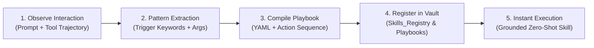

# 🛠️ Autopoietic Skill Synthesis Engine

The **Skill Synthesis Engine** is the self-expanding capability generator of CortexOS. Instead of relying on static, hardcoded scripts, CortexOS observes user workflows, recurring pairing requests, and novel tool chains to dynamically synthesize new procedural skills.



---

## 🔍 How Skill Synthesis Operates

1. **Trigger Recognition**:
   When the operator asks CortexOS to perform a new specialized procedure (e.g., *"launch ollama with qwen model"*, *"check bitcoin blockchain status"*, *"build docker dev container"*), or uses the command `"synthesize skill: <name>"`:
2. **Action Parameterization**:
   The engine extracts:
   - **Canonical Skill Name** (e.g. `LaunchLocalQwenLLM`)
   - **Trigger Keywords** (e.g. `['run qwen', 'start local llm', 'launch qwen streaming']`)
   - **Action Steps** (e.g. verify toolchain in [[05_System_State/Toolchains_and_Compilers|Toolchains]], navigate to workspace, execute command).
   - **Preconditions**: Verified ground-truth binary existence (e.g. `python`, `docker`, `git`).
3. **Vault Registration**:
   The skill is immediately committed as:
   - A dedicated note in `04_Skills_Catalog/Skill_<Name>.md`
   - An entry in [[04_Skills_Catalog/Skills_Registry|Skills Registry]]
   - An actionable playbook in [[02_Pair_Programming/Execution_Playbooks|Execution Playbooks]]
4. **Immediate Availability**:
   Once registered, the [[02_Pair_Programming/Pair_Programming_Copilot|Pair Copilot]] and cognitive loop can immediately match and execute the skill on demand!

---

## 📋 Standard Synthesized Skill Schema
```markdown
---
title: "Skill: <SkillName>"
type: "skill_definition"
category: "<Category>"
triggers:
  - "<trigger_phrase_1>"
  - "<trigger_phrase_2>"
grounded_toolchains:
  - "<required_tool>"
governance_tier: 1 | 2 | 3
---

### Execution Steps
1. ...
2. ...
```

---
> [!TIP] Self-Evolution Impact
> Every synthesized skill permanently enriches CortexOS's action vocabulary, transforming one-off user instructions into persistent operating system capabilities.
