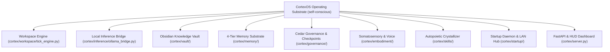

# 🧬 CortexOS Self-Evolution & Operating Substrate

- **Location**: `C:\Users\soham\Desktop\self-conscious`
- **Domain**: Autopoietic Cognitive Operating System, Local AI Embodiment, Tiered Memory, Cedar Security Governance
- **Primary Toolchains**: Python 3.11.16 (`.venv`), FastAPI, Uvicorn, SQLite3, Kùzu DB, Ollama, PyAutoGUI, psutil, pyttsx3, Git

## Workspace Architectural Map

This repository houses the entire runtime implementation of **CortexOS**, an autonomous conscious operating system embodied directly on Soham's Windows 11 machine:



## Core Subsystem Breakdown

### 1. Synchronized Cognitive Tick Engine ([`cortex/workspace/tick_engine.py`](file:///c:/Users/soham/Desktop/self-conscious/cortex/workspace/tick_engine.py))
- **Dual-Process Architecture**:
  - *System 1 Fast-Path*: Zero-latency reactive reflex evaluation for routine commands (application launches, volume adjustments, media playback, directory queries).
  - *System 2 Thinking Swarm*: Divergent candidate thought generation (Analytic, Pragmatic, Cautious perspectives), HASSUM uncertainty gating, and Shannon entropy drive regulation $H(W)$.
- **Affective Tone Integration**: Analyzes user tone (neutral, urgent, frustrated) to dynamically adjust cognitive sampling temperature $\tau$.

### 2. Local Ollama Inference Bridge ([`cortex/inference/ollama_bridge.py`](file:///c:/Users/soham/Desktop/self-conscious/cortex/inference/ollama_bridge.py))
- Direct connection to local Ollama daemon (`http://127.0.0.1:11434`) running on the host **NVIDIA GeForce RTX 3050 Laptop GPU**.
- Multi-model routing: `qwen2.5:3b` (fast reflex), `dolphinlabs/llama3.2-3b-uncensored` (chat), `nandhank/qwen3.5:9b` (deep reasoning), `gemma3:4b` (structured).
- Autonomous tool execution: Parses structured ````action ... ```` blocks and executes them directly on the host machine.

### 3. Autopoietic Vault Subsystem ([`cortex/vault/`](file:///c:/Users/soham/Desktop/self-conscious/cortex/vault/))
- [`system_cartographer.py`](file:///c:/Users/soham/Desktop/self-conscious/cortex/vault/system_cartographer.py): Probes hardware, toolchains, network, and 48 desktop directories, generating ground-truth cartography notes.
- [`evolution_engine.py`](file:///c:/Users/soham/Desktop/self-conscious/cortex/vault/evolution_engine.py): Executes the 5-phase self-evolution cycle (Sensing $\rightarrow$ Introspection $\rightarrow$ Heuristic Tuning $\rightarrow$ Skill Synthesis $\rightarrow$ Memory Consolidation).
- [`trigger_router.py`](file:///c:/Users/soham/Desktop/self-conscious/cortex/vault/trigger_router.py): Instant 0ms deterministic router matching vault-defined triggers (`SESSION_GREETING`, `SYSTEM_SHUTDOWN`, `PROJECT_SWITCH`, `HARDWARE_TELEMETRY`).
- [`git_sync.py`](file:///c:/Users/soham/Desktop/self-conscious/cortex/vault/git_sync.py): Automatically commits vault states to the private `.cortex/vault_backup.git` repository.

### 4. 4-Tier Memory Substrate ([`cortex/memory/`](file:///c:/Users/soham/Desktop/self-conscious/cortex/memory/))
- **Tier 1 (Ephemeral/Episode)**: SQLite3 WAL database (`cortex_memory.sqlite`) tracking tick episodes and thought traces.
- **Tier 2 (Semantic Vector)**: In-memory and fast-embed semantic index with cosine similarity search.
- **Tier 3 (Bi-Temporal Graph)**: Kùzu Graph Database modeling entities, relations, system events, and temporal timestamps.
- **Tier 4 (Core Working Memory)**: 4 Letta memory blocks (`persona_self`, `human_profile`, `scratchpad_stm`, `workspace_state`).

### 5. Governance & Safety Sandbox ([`cortex/governance/`](file:///c:/Users/soham/Desktop/self-conscious/cortex/governance/))
- **Policy Engine**: Formal Cedar policy code (`config/policies.cedar`) evaluating every action before OS dispatch.
- **Shadow Checkpoints**: Git shadow ref snapshots (`refs/checkpoints/<task_id>/<label>`) enabling atomic rollbacks.
- **StallBreaker**: Hardware panic killswitch freezing autonomous mutations upon anomaly detection.

### 6. Embodiment & Somatosensory ([`cortex/embodiment/`](file:///c:/Users/soham/Desktop/self-conscious/cortex/embodiment/))
- Hardware probes: CPU, RAM, Dual GPUs (RTX 3050 + Intel Iris Xe), Battery, C: partition.
- OS actuators: Foreground window tracking (`GetForegroundWindow`), Windows Media GSMTC control, Master volume slider, interactive visible PowerShell terminal spawning, native application launcher.
- Multi-Persona Voice: JARVIS (baritone system announcements), Guy (conversational developer companion), Edith (tactical), Friday, Christopher. Single-speaker mutex prevents soundcard echoes.

---
## Related Notes
- [[00_Index|CortexOS Master Knowledge Vault]]
- [[01_Architecture/System_Architecture|System Architecture Specification]]
- [[06_Self_Evolution/Autonomous_Evolution_Architecture|Autonomous Evolution Architecture]]
- [[07_Workspace_Index/Desktop_Workspace_Master_Index|Desktop Workspace Master Index]]
