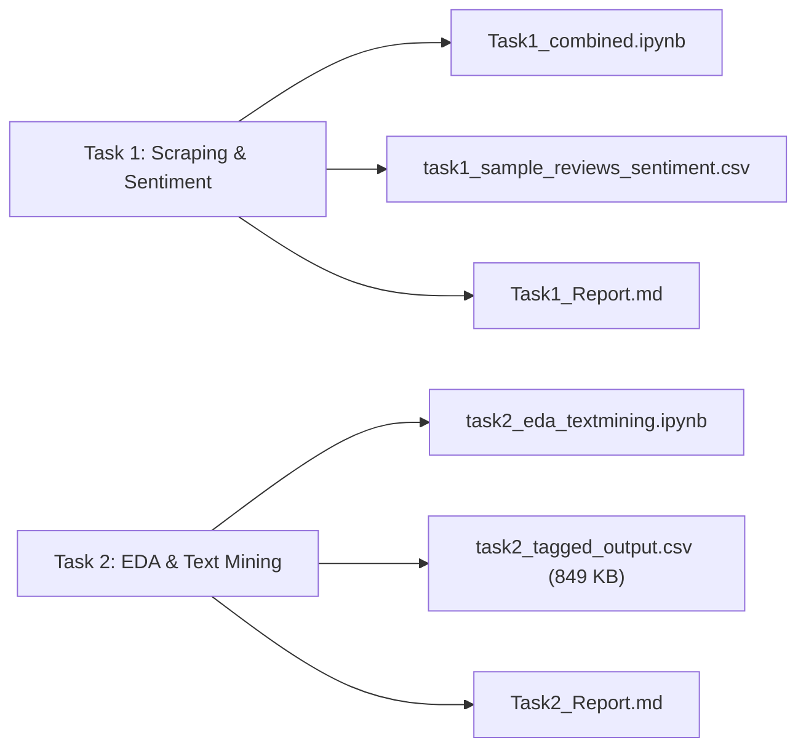

# 🤖 HanuAI ML Assessment & NLP Pipeline Workspace

- **Location**: `C:\Users\soham\Desktop\HanuAI_Tasks` (and `C:\Users\soham\Desktop\HanuAI`)
- **Domain**: Machine Learning, Web Scraping, Sentiment Analysis, Text Mining, Exploratory Data Analysis (EDA)
- **Primary Toolchains**: Python (Selenium, VADER, pandas, numpy, scikit-learn, matplotlib, seaborn, Jupyter Notebook)

## Workspace Architecture & Key Deliverables

This workspace contains Soham's complete submission for the HanuAI Machine Learning Assessment across two foundational tasks:

### Task 1: Web Scraping & Multi-Aspect Sentiment Analysis
1. **Scraping Pipeline (`Part A`)**:
   - Selenium automated browser driving BestBuy Canada product review extraction.
   - Evaluates all 5 mandatory sort filters: *Most Helpful*, *Newest*, *Highest Rating*, *Lowest Rating*, and *Most Relevant*.
   - Dynamic DOM pagination handling through continuous "Show More" expansion.
   - Strict `robots.txt` compliance checking before launching scraping sessions.
   - Extracts 7 canonical fields per review: Primary Key (`review_id`), Title, Text Body, Submission Date, Star Rating, Source Platform, and Reviewer Name. Deduplicates records across multi-sort passes.
2. **Sentiment Analysis (`Part B`)**:
   - Implements VADER (Valence Aware Dictionary and sEntiment Reasoner) scoring optimized for colloquial text.
   - Computes compound, positive, neutral, and negative sentiment polarities.
   - Keyword-based aspect extraction segmenting feedback into product dimensions (battery, display, performance, audio, build quality).

### Task 2: Advanced Exploratory Data Analysis & Text Mining
1. **Corpus & Datasets**:
   - Source data: `Hanuai task2 assignment.xlsx` (216 KB).
   - Enriched tagged output: `task2_tagged_output.csv` (849 KB, multi-thousand review tokens).
2. **Text Mining Pipeline (`task2_eda_textmining.ipynb`)**:
   - Preprocessing: lowercasing, regex token cleaning, stopword removal, lemmatization.
   - Frequency distribution modeling: N-gram extraction (unigrams, bigrams, trigrams).
   - Topic clustering and TF-IDF term weighting.
   - Insight quantification exported as `task2_insights_summary.json`.
3. **Stakeholder Reports**:
   - `Task1_Report.md` (9.6 KB): Methodology, scraping ethics, sentiment distributions, model limitations.
   - `Task2_Report.md` (10.1 KB): Customer pain point clustering, correlation matrices, actionable business recommendations.

---
## Related Notes
- [[07_Workspace_Index/Desktop_Workspace_Master_Index|Desktop Workspace Master Index]]
- [[05_System_State/Filesystem_and_Workspaces|Filesystem and Workspaces Map]]
- [[05_System_State/Toolchains_and_Compilers|Toolchains and Compilers]]
