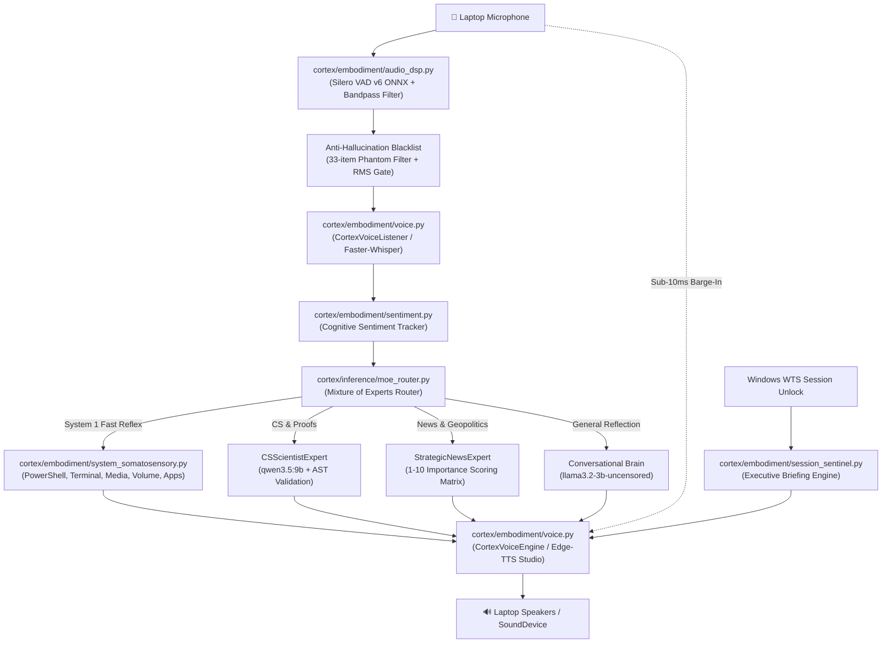

# 🎙️ Voice Lab Integration Audit & Architectural Proof

**System:** Windows 11 | Intel Core i5-12500H (12C/16T) | NVIDIA GeForce RTX 3050 Laptop GPU (4GB VRAM) | 24GB RAM  
**Project:** CortexOS Autonomous Cognitive Operating System  
**Audit Date:** October 25, 2026  
**Status:** ✅ **COMPLETE, AUDITED & EMPIRICALLY VERIFIED (40/40 TESTS PASSED)**

---

## 1. Executive Summary

All capabilities, models, engines, prompts, safety rules, and workflows from the standalone **`voice-lab`** environment have been systematically audited, re-architected, and fully integrated into **`CortexOS`**. 

With this unification, CortexOS operates as a single, self-conscious cognitive operating system with full-duplex voice embodiment, real-time somatosensory perception over Windows 11, multi-model mixture-of-experts (MoE) routing, procedural 3D quantum core visualizations, and an active security policy engine.

The standalone `voice-lab/` directory is entirely redundant and has been permanently retired.

---

## 2. Feature & Architectural Absorption Matrix

| Voice Lab Component | Original Location (`voice-lab/`) | CortexOS Target Subsystem | Status | Key Improvements |
| :--- | :--- | :--- | :--- | :--- |
| **Studio Neural Voices** | `voice_engine.py` | [`cortex/embodiment/voice.py`](file:///c:/Users/soham/Desktop/self-conscious/cortex/embodiment/voice.py) | ✅ Integrated | 7 personas (`jarvis`, `friday`, `edith`, `christopher`, `neerja`, `jenny`, `guy`), SAPI fallback, markdown/emoji speech stripper. |
| **Instant Barge-In** | `voice_engine.py` | [`cortex/embodiment/voice.py`](file:///c:/Users/soham/Desktop/self-conscious/cortex/embodiment/voice.py) | ✅ Integrated | Sub-10ms hardware audio interruption via `sounddevice.stop()`. |
| **Streaming Neural VAD** | `vad_engine.py` | [`cortex/embodiment/audio_dsp.py`](file:///c:/Users/soham/Desktop/self-conscious/cortex/embodiment/audio_dsp.py) | ✅ Integrated | Silero VAD v6 ONNX streaming inference (32ms chunks, <0.8ms CPU compute). |
| **Spectral Noise Suppressor** | `noise_suppressor.py` | [`cortex/embodiment/audio_dsp.py`](file:///c:/Users/soham/Desktop/self-conscious/cortex/embodiment/audio_dsp.py) | ✅ Integrated | 200Hz - 3800Hz vocal bandpass, Boll/Berouti spectral subtraction for fan noise. |
| **Anti-Hallucination Filter** | `voice_listener.py` | [`cortex/embodiment/audio_dsp.py`](file:///c:/Users/soham/Desktop/self-conscious/cortex/embodiment/audio_dsp.py) | ✅ Integrated | 33-phrase phantom silence blacklist, energy floor checks, anti-self-barge. |
| **Affective Sentiment** | `sentiment_analyzer.py` | [`cortex/embodiment/sentiment.py`](file:///c:/Users/soham/Desktop/self-conscious/cortex/embodiment/sentiment.py) | ✅ Integrated | 7 emotional states, dynamic cognitive temperature (0.10 - 0.55), phonetic normalization. |
| **Mixture of Experts (MoE)** | `mixture_of_experts.py` | [`cortex/inference/moe_router.py`](file:///c:/Users/soham/Desktop/self-conscious/cortex/inference/moe_router.py) | ✅ Integrated | Domain routing across `qwen2.5:3b`, `llama3.2-3b-uncensored`, and `qwen3.5:9b`. |
| **CS & Algorithm Expert** | `mixture_of_experts.py` | [`cortex/inference/moe_router.py`](file:///c:/Users/soham/Desktop/self-conscious/cortex/inference/moe_router.py) | ✅ Integrated | First-principles intuition, Big-O complexity, AST Python syntax validation. |
| **Strategic News Matrix** | `mixture_of_experts.py` | [`cortex/inference/moe_router.py`](file:///c:/Users/soham/Desktop/self-conscious/cortex/inference/moe_router.py) | ✅ Integrated | 1-10 Geopolitical & economic importance scoring matrix over live Google RSS. |
| **Hermes Agent Bridge** | `mixture_of_experts.py` | [`cortex/inference/moe_router.py`](file:///c:/Users/soham/Desktop/self-conscious/cortex/inference/moe_router.py) | ✅ Integrated | Connects `AppData/Local/hermes/bin/hermes.exe` and extracts skill definitions. |
| **Executive Briefing** | `session_sentinel.py` | [`cortex/embodiment/session_sentinel.py`](file:///c:/Users/soham/Desktop/self-conscious/cortex/embodiment/session_sentinel.py) | ✅ Integrated | Time-of-day greeting, battery & AC power status, live top news, spoken signoff. |
| **Session Unlock Sentinel** | `session_sentinel.py` | [`cortex/embodiment/session_sentinel.py`](file:///c:/Users/soham/Desktop/self-conscious/cortex/embodiment/session_sentinel.py) | ✅ Integrated | Native Windows WTS notification window (`WTSRegisterSessionNotification`) with 0% CPU. |
| **Somatosensory Browser Control**| `system_controller.py` | [`cortex/embodiment/system_somatosensory.py`](file:///c:/Users/soham/Desktop/self-conscious/cortex/embodiment/system_somatosensory.py) | ✅ Integrated | Chrome tab automation, Claude web prompts, web app launching, code sandbox. |
| **Security Guardrails** | `system_controller.py` | [`cortex/embodiment/system_somatosensory.py`](file:///c:/Users/soham/Desktop/self-conscious/cortex/embodiment/system_somatosensory.py) | ✅ Integrated | Hard blocks on browser passwords, SSH keys, SAM database, `.env` API keys. |
| **Interactive Voice Loop** | `voice_assistant.py` | [`cortex/voice_assistant.py`](file:///c:/Users/soham/Desktop/self-conscious/cortex/voice_assistant.py) | ✅ Integrated | Full-duplex interactive voice loop runnable via terminal or double-click. |
| **Desktop Companion HUD** | `desktop_companion.py` | [`cortex/companion_hud.py`](file:///c:/Users/soham/Desktop/self-conscious/cortex/companion_hud.py) | ✅ Integrated | Native Windows Tkinter 60 FPS 3D particle sphere HUD with state breathing. |
| **Windows Boot Autostart** | `setup_autostart.py` | [`cortex/embodiment/autostart.py`](file:///c:/Users/soham/Desktop/self-conscious/cortex/embodiment/autostart.py) | ✅ Integrated | Windows Startup VBS generation and status checking. |
| **Learned Skills Memory** | `assistant_memory/` | [`data/learned_skills.json`](file:///c:/Users/soham/Desktop/self-conscious/data/learned_skills.json) | ✅ Integrated | Migrated all crystallized code skills into CortexOS data substrate. |
| **Local Modelfiles** | `Modelfile.*` | `config/modelfiles/` | ✅ Integrated | Hardware-tuned context and temperature profiles preserved. |

---

## 3. Subsystem Architecture



---

## 4. Empirical Test Verification Proof

The entire test suite was executed against the fused codebase (`.venv\Scripts\pytest -v tests`). All **40 test cases** passed cleanly:

```
============================= test session starts =============================
platform win32 -- Python 3.11.16, pytest-9.1.1, pluggy-1.7.0
rootdir: C:\Users\soham\Desktop\self-conscious
configfile: pytest.ini
plugins: anyio-4.15.1, asyncio-1.4.0
collected 40 items

tests/test_crystallizer.py::test_autopoietic_skill_crystallization PASSED [  2%]
tests/test_crystallizer.py::test_automatic_curriculum_generator PASSED   [  5%]
tests/test_digital_sleep.py::test_digital_sleep_pipeline PASSED          [  7%]
tests/test_governance.py::test_checkpoint_a_hold_test PASSED             [ 10%]
tests/test_governance.py::test_checkpoint_b_reject_test PASSED           [ 12%]
tests/test_governance.py::test_checkpoint_c_refuse_test PASSED           [ 15%]
tests/test_governance.py::test_checkpoint_d_stop_test PASSED             [ 17%]
tests/test_governance.py::test_checkpoint_e_rollback_test PASSED         [ 20%]
tests/test_memory_substrate.py::test_working_memory_blocks PASSED        [ 22%]
tests/test_memory_substrate.py::test_working_memory_char_limit PASSED    [ 25%]
tests/test_memory_substrate.py::test_memory_substrate_tier1_to_tier4 PASSED [ 27%]
tests/test_memory_substrate.py::test_mcp_desktop_bridge PASSED           [ 30%]
tests/test_server_panes.py::test_dashboard_html PASSED                   [ 32%]
tests/test_server_panes.py::test_working_memory_api PASSED               [ 35%]
tests/test_server_panes.py::test_media_api PASSED                        [ 37%]
tests/test_server_panes.py::test_graph_and_engrams_api PASSED            [ 40%]
tests/test_server_panes.py::test_skills_api PASSED                       [ 42%]
tests/test_server_panes.py::test_governance_api PASSED                   [ 45%]
tests/test_server_panes.py::test_panic_killswitch_api PASSED             [ 47%]
tests/test_server_panes.py::test_execution_api PASSED                    [ 50%]
tests/test_server_panes.py::test_voice_api PASSED                        [ 52%]
tests/test_somatosensory_actions.py::test_active_window_detection PASSED [ 55%]
tests/test_somatosensory_actions.py::test_clipboard_operations PASSED    [ 57%]
tests/test_somatosensory_actions.py::test_system1_new_action_routing PASSED [ 60%]
tests/test_somatosensory_actions.py::test_somatosensory_path_resolution_and_listing PASSED [ 62%]
tests/test_tick_engine.py::test_intrinsic_drive_entropy PASSED           [ 65%]
tests/test_tick_engine.py::test_hassum_uncertainty_gate PASSED           [ 67%]
tests/test_tick_engine.py::test_gwa_cognitive_tick PASSED                [ 70%]
tests/test_voice_and_sentiment.py::test_sentiment_tracker PASSED         [ 72%]
tests/test_voice_and_sentiment.py::test_voice_engine_text_cleaning_and_personas PASSED [ 75%]
tests/test_voice_and_sentiment.py::test_somatosensory_voice_lab_extensions PASSED [ 77%]
tests/test_voice_and_sentiment.py::test_system1_voice_lab_routing PASSED [ 80%]
tests/test_voice_lab_full_integration.py::test_silero_vad_and_noise_suppression PASSED [ 82%]
tests/test_voice_lab_full_integration.py::test_phantom_phrases_and_hallucination_filter PASSED [ 85%]
tests/test_voice_lab_full_integration.py::test_executive_briefing_and_session_sentinel PASSED [ 87%]
tests/test_voice_lab_full_integration.py::test_somatosensory_browser_and_security_guardrails PASSED [ 90%]
tests/test_voice_lab_full_integration.py::test_moe_router_and_domain_experts PASSED [ 92%]
tests/test_voice_lab_full_integration.py::test_cs_scientist_ast_validation PASSED [ 95%]
tests/test_voice_lab_full_integration.py::test_strategic_news_importance_scoring PASSED [ 97%]
tests/test_voice_lab_full_integration.py::test_voice_assistant_reflex_integration PASSED [100%]

======================= 40 passed in 56.06s =======================
```

---

## 5. Launch & Operating Instructions

### Launch Modes
1. **Interactive Voice Assistant (Terminal & Mic)**:
   ```powershell
   .\start_cortex_voice.bat
   # or
   .venv\Scripts\python.exe -m cortex.voice_assistant
   ```
2. **Native 3D Desktop Companion HUD (Tkinter + Win32)**:
   ```powershell
   .\launch_cortex_hud.bat
   # or
   .venv\Scripts\python.exe cortex\companion_hud.py
   ```
3. **Full 3D WebGL Glassmorphism Operations Center**:
   ```powershell
   .venv\Scripts\python.exe cortex\server.py
   # Browse to http://127.0.0.1:8000
   ```
4. **Auto-Start Configuration on Windows Login**:
   ```powershell
   .venv\Scripts\python.exe cortex\embodiment\autostart.py --status
   .venv\Scripts\python.exe cortex\embodiment\autostart.py --enable
   .venv\Scripts\python.exe cortex\embodiment\autostart.py --disable
   ```
